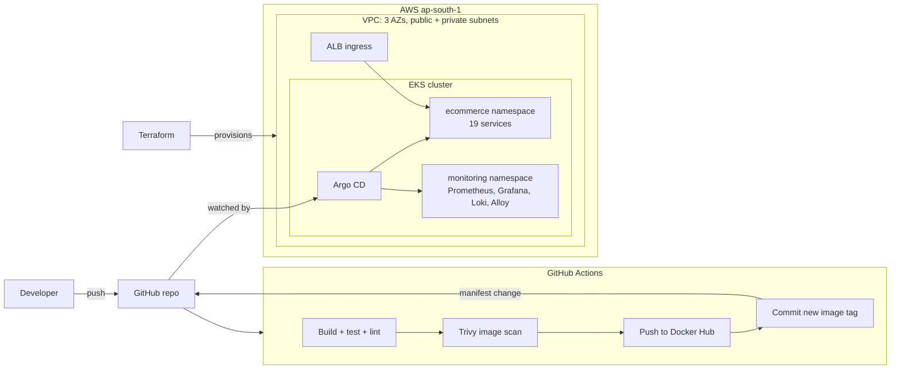

# ecommerce-eks-gitops

A 19-service e-commerce shop running on AWS EKS. The infrastructure is built with Terraform, CI is GitHub Actions, deployment is GitOps with Argo CD, and Prometheus, Grafana and Loki handle metrics and logs.

The application is the [OpenTelemetry Astronomy Shop demo](https://github.com/open-telemetry/opentelemetry-demo) (Apache-2.0). Everything around it is the work in this repo: infrastructure, pipelines, Kubernetes manifests, GitOps and monitoring.

## Architecture



1. A push to `src/product-catalog/` runs CI. The image is built, tested and scanned, and the build fails on fixable CRITICAL CVEs.
2. CI pushes the image and commits the new tag to `kubernetes/productcatalog/deploy.yaml`.
3. Argo CD sees the commit and rolls out the change. Nobody runs `kubectl apply` by hand.

## Repository layout

| Path | What it is |
| --- | --- |
| [`terraform/`](terraform/) | VPC + EKS for `dev` and `prod`, with S3 state and its own CI checks ([details](terraform/README.md)) |
| [`kubernetes/`](kubernetes/) | Deployments and Services for all 19 services, plus the ALB ingress |
| [`argocd/`](argocd/) | App-of-apps: the shop, kube-prometheus-stack, Loki, Alloy |
| [`.github/workflows/`](.github/workflows/) | `ci.yaml` (product-catalog build and deploy), `terraform.yaml` (fmt, validate, tflint, checkov) |
| `src/` | Application source from the upstream demo |

## Pipelines

| Workflow | Runs on | Steps |
| --- | --- | --- |
| `product-catalog-ci` | PR and push to `main` touching `src/product-catalog/` | Build, `go test`, golangci-lint; on `main` also image build, Trivy scan, push, manifest commit |
| `terraform` | PR and push to `main` touching `terraform/` | `terraform fmt`, `validate`, TFLint (AWS ruleset), Checkov |

Checkov runs clean: accepted risks are skipped inline in the `.tf` files, each with a written reason.

## Deploy it

Requirements: an AWS account, Terraform ≥ 1.10, `kubectl`, `helm`.

```bash
# 1. Infrastructure (see terraform/README.md for the one-time state bucket)
cd terraform
terraform init -backend-config=envs/dev.backend.hcl
terraform apply -var-file=envs/dev.tfvars
$(terraform output -raw kubeconfig_command)

# 2. AWS Load Balancer Controller (serves the ALB ingress)
#    Follow https://kubernetes-sigs.github.io/aws-load-balancer-controller/
#    using the OIDC provider from `terraform output oidc_provider_arn`.

# 3. Argo CD
kubectl create namespace argocd
kubectl apply -n argocd -f https://raw.githubusercontent.com/argoproj/argo-cd/stable/manifests/install.yaml

# 4. Grafana admin secret, then hand everything to Argo CD
kubectl create namespace monitoring
kubectl -n monitoring create secret generic grafana-admin \
  --from-literal=admin-user=admin --from-literal=admin-password='<password>'
kubectl apply -n argocd -f argocd/root.yaml

# 5. Open the shop
kubectl -n ecommerce get ingress frontend-proxy
```

CI needs a repo variable `DOCKER_USERNAME` and a secret `DOCKER_TOKEN` (Docker Hub access token).

**Cost:** EKS, NAT gateways and nodes bill by the hour. Run `terraform destroy -var-file=envs/dev.tfvars` when you're done.

## Design choices

- **Dev is cheap, prod is resilient, both from the same code.** Dev uses one NAT gateway and Spot nodes. Prod uses a NAT gateway per AZ and on-demand nodes.
- **GitOps over `kubectl`.** Git is the source of truth; Argo CD self-heals any drift in the cluster.
- **Security gates in CI.** Trivy fails the build on fixable CRITICAL CVEs, and Checkov blocks insecure Terraform.
- **Secrets stay out of git.** Terraform state lives in S3, and the Grafana password lives in a Kubernetes secret.
- **Kubernetes secrets are encrypted** with a KMS key.

## Next steps

- [ ] Deploy the OpenTelemetry Collector so traces and app metrics reach Prometheus (the services already export to `opentelemetry-demo-otelcol`)
- [ ] Extend CI to the remaining services with a reusable workflow
- [ ] Route 53 record + ACM certificate for HTTPS on the ingress
- [ ] Install the AWS Load Balancer Controller through Terraform and IRSA instead of by hand

## Credits

- Application: [open-telemetry/opentelemetry-demo](https://github.com/open-telemetry/opentelemetry-demo), Apache-2.0
- Terraform module base: [iam-veeramalla/ultimate-devops-project-aws](https://github.com/iam-veeramalla/ultimate-devops-project-aws), Apache-2.0

Licensed under Apache-2.0; see [LICENSE](LICENSE).
